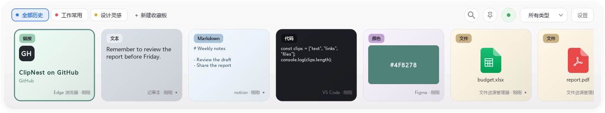
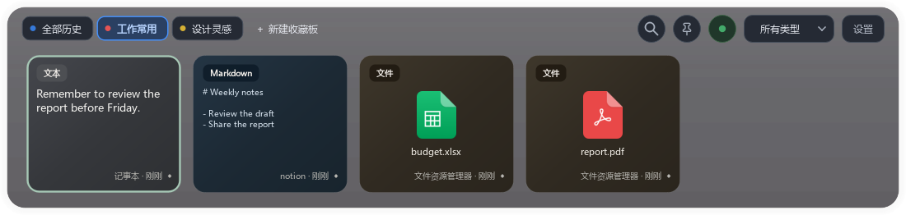
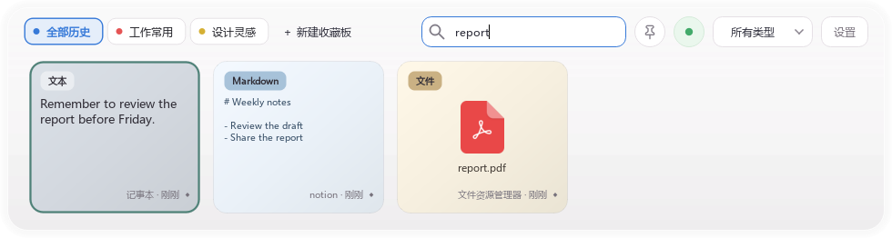
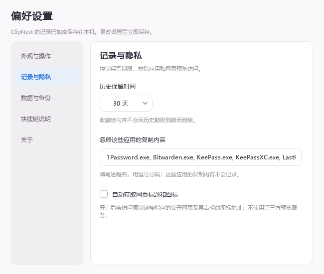

# ClipNest

[简体中文](README.md) · [繁體中文](README.zh-TW.md) · [English](README.en.md)

> **Codex Vibe Coding 项目**：ClipNest 由维护者与 Codex 协作开发，维护者负责需求选择、测试与发布。

一款适用于 Windows 的本地剪贴板历史工具。复制过的文字、Markdown、链接、代码、颜色、图片和文件，会以卡片形式留在桌面底部；需要时用快捷键调出、搜索并重新粘贴。

> 当前正式版：**1.00.5** · Windows x64 · [下载安装包](https://github.com/NigoNiko/clipnest/releases/latest)

## 界面预览

以下截图使用演示数据制作，不包含真实剪贴记录。

### 默认模式 · 全部历史

文字、Markdown、链接、代码、颜色和文件显示在同一条卡片栏中；顶部可切换收藏夹、搜索和按类型筛选。

### 黑暗模式 · 收藏夹

收藏夹用不同颜色的圆点区分，常用内容可集中保存；收藏夹中的卡片支持拖动排序。

### 搜索与筛选

搜索栏会在窗口内展开，输入关键词后即时筛选历史记录；旁边的类型菜单可只显示文本、Markdown、链接、代码、颜色、图片或文件。

### 记录与隐私设置

可调整历史保留时间、排除不希望记录的应用，并选择是否自动获取网页标题和图标。设置中的外观页面还可切换默认／黑暗模式和窗口透明度。

## 主要功能

- **快速找回与粘贴**：默认按 `Ctrl + Alt + Q` 打开卡片栏，支持搜索、类型筛选和键盘选择。可直接粘贴到刚才使用的应用，也可只复制到剪贴板。
- **多种内容预览**：区分普通文本、Markdown、代码、链接、颜色、图片和文件。Markdown 同时保留源码及富文本格式，由目标应用选择可用的粘贴格式；链接尝试读取网页标题和网站图标。
- **收藏夹**：把常用内容放入不同收藏夹，设置识别色，并通过拖动调整卡片顺序。窗口内可用 `Ctrl + 1～9`、`Ctrl + 0` 切换全部历史与前九个收藏夹，其余收藏夹可设置自己的快捷键。
- **可控的记录行为**：可以暂停记录、设置历史保留时间、忽略指定应用，并管理开机启动。程序默认跳过常见密码管理器进程及声明不应保存的剪贴板内容；忽略规则不能保证识别所有敏感内容。
- **本地数据保护**：历史记录、图片、链接预览和设置存于 SQLCipher 加密数据库；数据库密钥由当前 Windows 账户的 DPAPI 保护。没有云端同步。备份和迁移可在设置中操作。
- **安装、更新与卸载**：安装包支持覆盖升级；“设置 → 关于”可检查 GitHub Release 并安装更新。卸载时可选择保留或清除本地记录。

## 安装与使用

1. 从 [Releases](https://github.com/NigoNiko/clipnest/releases/latest) 下载 `ClipNest-1.00.5-Setup-x64.exe`，在 Windows x64 上运行。
2. 启动后，ClipNest 驻留在系统托盘。复制内容后，按 `Ctrl + Alt + Q` 呼出卡片栏。
3. 选择卡片即可再次使用；右键卡片可以编辑、重命名、收藏、复制或删除。

默认安装在 `%LOCALAPPDATA%\Programs\ClipNest`，数据默认保存在 `%LOCALAPPDATA%\ClipNest`。正常覆盖升级会保留数据；交互式卸载时可选择是否删除数据和密钥。需要完整操作说明，请看 [桌面版使用文档](desktop/README.md)。

实时模糊背景需要 [微软 .NET 8 Runtime（x64）](https://dotnet.microsoft.com/download/dotnet/8.0)。若未安装，ClipNest 会提供下载入口，其他功能仍可使用。

此前的 `1.34.7` 属于 Beta 测试版。该版本按数字比较更新，无法自动识别号码较小的正式版 `1.00.0`；测试版用户请手动下载安装包覆盖安装一次，原有记录和设置会保留。之后正式版可继续在“设置 → 关于”在线更新。

当前发布的安装包尚未进行代码签名。Windows 可能显示“未知发布者”或 SmartScreen 提示。只从本仓库的 Release 下载，并核对 GitHub 显示的文件 SHA-256；代码签名方案仍在评估中。

## 隐私说明

剪贴板记录只保存在本机，不会上传到 ClipNest 服务器。启用网页预览时，程序会访问复制链接所指向的网站及其声明的图标地址；检查更新时会访问 GitHub。网页预览可在设置中关闭。数据库密钥与当前 Windows 账户绑定，复制数据库及密钥文件到其他电脑通常不能直接读取记录；这不等同于防止已登录本机账户的程序读取数据。

## 致谢与灵感

ClipNest 的底部卡片式浏览体验受到 [Paste](https://pasteapp.io/) 的启发；ClipNest 是独立开发的 Windows 应用，与 Paste 无关联，也未使用 Paste 的品牌或素材。

项目使用或构建时依赖以下开源项目：

| 项目 | 用途 | 许可与项目地址 |
| --- | --- | --- |
| Qt for Python / PySide6 | 桌面界面 | [LGPLv3/GPLv3 或商业许可](https://doc.qt.io/qtforpython-6/) |
| SQLCipher | 加密数据库 | [BSD 风格许可与版权声明](https://www.zetetic.net/sqlcipher/license/) |
| sqlcipher3 | Python 与 SQLCipher 的连接 | [PyPI 项目](https://pypi.org/project/sqlcipher3/) |
| PyInstaller | 将 Python 应用打包为 Windows 程序 | [许可说明](https://pyinstaller.org/en/stable/license.html) |
| Inno Setup | 生成 Windows 安装程序 | [项目与许可信息](https://jrsoftware.org/isinfo.php) |

第三方项目各自保留其版权和许可。文件预览图标由 **[SeeRgb](https://dribbble.com/SeeRgb)** 创作，原作品为 [File icon freebie](https://dribbble.com/shots/6273084-File-icon)。SeeRgb 已书面授权 ClipNest 使用、调整和再分发这组图标，包括在公开源码、安装包、项目截图及后续版本中使用；下载、分叉或再分发 ClipNest 的人也可在项目中继续使用和修改，包括商业用途。图标版权仍归 SeeRgb 所有，**不属于 ClipNest 自有代码的 MIT 许可范围**。详见 [图标来源与授权说明](desktop/assets/file-icons/SOURCE.md)。

ClipNest 自己编写的代码使用 [MIT 许可证](LICENSE)。完整的第三方声明见 [THIRD-PARTY-NOTICES.md](THIRD-PARTY-NOTICES.md)。

## 从源码构建

构建环境为 Windows x64、Python 3.12、.NET 8 SDK、PySide6 6.9.2、PyInstaller 6.16.0、sqlcipher3 0.6.2 和 Inno Setup 7。构建入口为 [`desktop/build-release.ps1`](desktop/build-release.ps1)；当前源码位于 `desktop/versions/1.00.5/`。详细说明见 [桌面版使用文档](desktop/README.md)。
